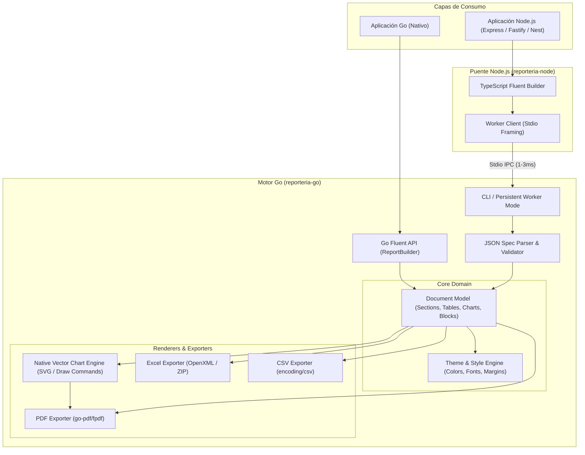

# Arquitectura General: reporteria-go

## 1. Visión del Proyecto
`reporteria-go` es un motor de generación de reportes ultra-rápido, ergonómico y ligero, desarrollado en **Go** y diseñado para ser consumido tanto de forma nativa en **Go** como a través de un puente de alto rendimiento en **Node.js (TypeScript/JavaScript)**.

El objetivo principal es permitir la creación fluida de reportes con:
- Encabezados, títulos y párrafos formateados.
- Tablas estilizadas con ajuste automático, bordes y filas alternadas (*zebra striping*).
- Gráficos estadísticos vectoriales (barras, líneas, pastel/dona) sin dependencias pesadas.
- Inserción de imágenes y métricas.
- Exportación multiformato: **PDF**, **Excel (.xlsx)** y **CSV**.
- Consumo en Node.js en **1 a 3 ms por reporte** utilizando el patrón **Persistent Worker vía Stdio IPC**.

---

## 2. Filosofía de Mínimas Dependencias
Para garantizar máxima velocidad de compilación, peso mínimo del binario y portabilidad absoluta sin necesidad de compiladores C (CGO), el proyecto se adhiere a una política de **mínimas dependencias**:

| Módulo | Enfoque Técnico | Dependencias Externas |
| :--- | :--- | :--- |
| **Gráficos** | Motor vectorial nativo en Go (`pkg/charts`) | **0** (solo `math` y Go stdlib) |
| **PDF** | Renderizador basado en `github.com/go-pdf/fpdf` | **1** (cero transitivas) |
| **Excel (.xlsx)** | Generador OpenXML directo (`archive/zip` + `encoding/xml`) | **0** (Go stdlib) |
| **CSV** | Formateador nativo `encoding/csv` | **0** (Go stdlib) |
| **CLI / Worker** | Protocolo binario/JSON framed por Stdio | **0** (Go stdlib) |

> **Resultado**: El proyecto Go tiene exactamente **1 sola dependencia externa** (`go-pdf/fpdf`).

---

## 3. Diagrama de Arquitectura



---

## 4. Estructura de Directorios

```
reporteria-go/
├── .agents/
│   ├── docs/
│   │   ├── ARCHITECTURE.md     # Este documento
│   │   └── ROADMAP.md          # Control y seguimiento de fases
│   └── specs/                  # Especificaciones técnicas detalladas (01 a 07)
├── cmd/
│   └── reporteria-cli/         # Entrypoint del ejecutable (One-shot y --worker)
├── pkg/
│   ├── reporter/               # API Fluida Go y modelo de documento
│   ├── charts/                 # Motor de gráficos vectoriales (0 deps)
│   ├── exporters/              # Generadores de PDF, Excel y CSV
│   └── spec/                   # Especificación JSON compartida Go <-> Node
├── nodejs-wrapper/             # Paquete npm (@reporteria/node)
├── examples/                   # Ejemplos de uso en Go y Node.js
├── tests/                      # Benchmarks y pruebas de integración
├── go.mod
└── README.md
```

---

## 5. Decisiones Técnicas Clave
1. **Gráficos vectoriales en PDF**: Al dibujar directamente las figuras en el lienzo vectorial del PDF, se evita generar bitmaps intermediarios (PNG), logrando que los gráficos no pesen nada y se vean con nitidez perfecta a cualquier nivel de zoom.
2. **Generador Excel Streaming**: Escribir los XML de OpenXML directamente en el empaquetador ZIP estándar de Go evita almacenar grandes árboles DOM en memoria, procesando hojas con miles de filas en milisegundos.
3. **Persistent Worker Stdio IPC**: Node.js arranca el binario una sola vez con `--worker`. Se comunican mediante un protocolo binario prefijado con tamaño de 4 bytes (`uint32 length-prefixed payload`). Esto evita crear y matar procesos por cada reporte.
