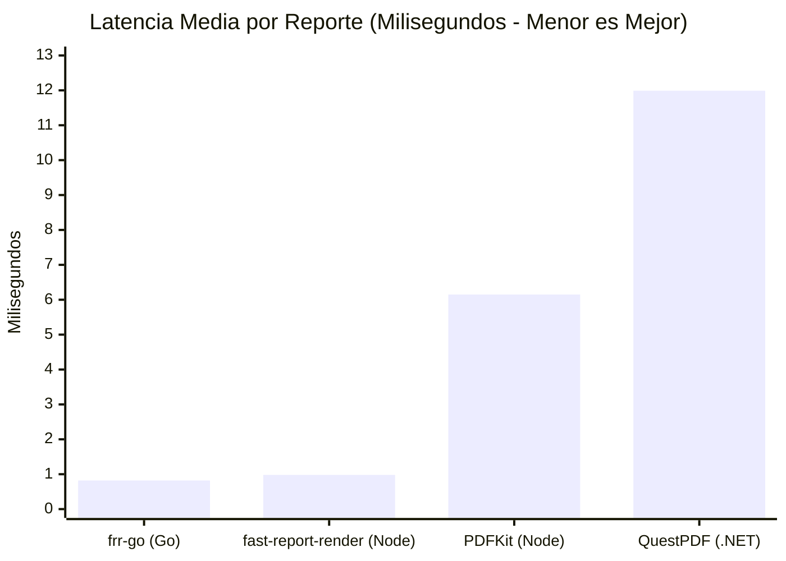
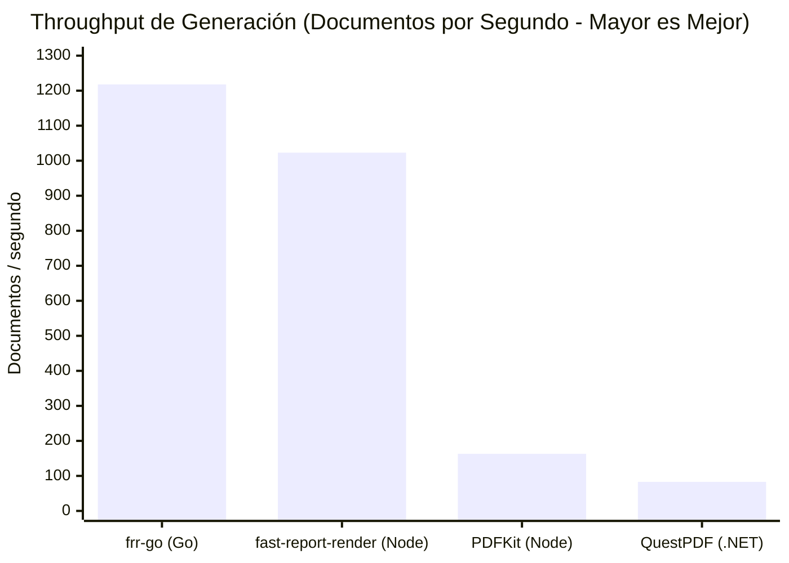

# Comparativa de Rendimiento y Arquitectura: frr-go vs QuestPDF vs PDFKit

Este documento presenta un análisis técnico y empírico comparando tres de los motores de generación de reportes más relevantes en la industria moderna:

1. **`frr-go` / `fast-report-render`**: Motor en Go nativo y wrapper para Node.js mediante arquitectura Persistent Worker IPC.
2. **`QuestPDF`**: El motor líder de alto rendimiento en el ecosistema .NET (C#) basado en Google Skia (SkiaSharp).
3. **`PDFKit`**: La biblioteca por defecto más utilizada para generación programática en el ecosistema Node.js / JavaScript.

---

## 1. Entorno de Pruebas (Testbed)

Todas las pruebas se ejecutaron sobre hardware real idéntico bajo condiciones controladas:

- **CPU**: Intel Core i5-11400H @ 2.70GHz (6 núcleos, 12 hilos)
- **RAM**: 16 GB DDR4
- **Sistema Operativo**: Windows 11 Pro 64-bit
- **Runtimes**:
  - Go: `go1.26.4 windows/amd64`
  - Node.js: `v24.15.0`
  - .NET: `10.0.101 (Release build)`
- **Carga de prueba**: Documento empresarial estándar A4 compuesto por:
  - Título y subtítulo con estilos corporativos.
  - 2 tarjetas KPI de resumen financiero (Ingresos y Transacciones).
  - Tabla de 25 filas x 5 columnas con cabecera de color azul corporativo, bordes y zebra striping alternado.
  - Paginación automática (`Página X de Y`).
- **Muestreo**: 100 documentos generados consecutivamente tras una fase de calentamiento (*warm-up*) de 5 iteraciones.

---

## 2. Resultados Empíricos del Benchmark

```
========================================================================================
🔬 RESULTADOS CONSOLIDADOS (100 iteraciones - Documento A4 con KPIs y Tabla de 25 filas)
========================================================================================
```

| Motor / Biblioteca | Runtime / Entorno | Latencia Media | Mediana (P50) | Percentil 95 (P95) | Mínimo | Máximo | Throughput | Peso del PDF |
| :--- | :--- | :--- | :--- | :--- | :--- | :--- | :--- | :--- |
| 🥇 **`frr-go` (Nativo)** | Go 1.26 (Compilado) | **0.82 ms** | **0.81 ms** | **1.05 ms** | 0.71 ms | 1.30 ms | **~1,218 doc/s** | 3.5 KB |
| 🥈 **`fast-report-render`** | Node.js + Go IPC | **0.98 ms** | **0.97 ms** | **1.24 ms** | 0.75 ms | 1.43 ms | **~1,023 doc/s** | 3.5 KB |
| 🥉 **`PDFKit`** | Node.js (V8 puro) | **6.15 ms** | **5.79 ms** | **8.47 ms** | 4.63 ms | 14.33 ms | **~163 doc/s** | 3.0 KB |
| 4️⃣ **`QuestPDF`** | .NET 10 (SkiaSharp) | **11.99 ms** | **11.43 ms** | **16.82 ms** | 9.95 ms | 18.29 ms | **~83 doc/s** | 48.3 KB |

---

## 3. Gráficas Comparativas

### Latencia Media por Documento (Menor es mejor)


### Throughput de Generación (Mayor es mejor)


---

## 4. Análisis Arquitectónico y Cuellos de Botella

### 1. `frr-go` / `fast-report-render` (Go + Stdio Binary IPC)
- **Por qué es el más rápido**:
  - Compilado nativo sin máquina virtual ni garbage collector pesado compitiendo por pausas largas.
  - El motor de diseño vectorial calcula geometría plana directamente en memoria contigua.
  - Al invocarse desde Node.js, utiliza el protocolo de **Worker Persistente**: el proceso Go se inicia una sola vez y escucha tramas binarias pre-fijadas por longitud de 4 bytes (`uint32be`). Esto evita los ~20 ms de arranque del sistema operativo y traslada el cómputo fuera del hilo de Node.js.
  - **Impacto en el Event Loop de Node.js**: Prácticamente nulo. El Event Loop solo escribe y lee buffers de sockets/pipes sin bloquearse.

### 2. `PDFKit` (JavaScript Puro sobre V8)
- **Comportamiento**:
  - Genera llamadas imperativas directas (`doc.text()`, `doc.rect()`).
  - No cuenta con motor de layout automático: el desarrollador debe calcular manualmente las coordenadas $(x, y)$, los anchos de columnas y el salto de página, o añadir librerías adicionales que suman lentitud (como `pdfmake` o `pdfkit-table`).
  - **Cuello de Botella**: Es monohilo en Node.js. Ejecutar 100 reportes consume **615 ms de bloqueo total del hilo de Node.js**. Durante ese tiempo, la API web no puede procesar otras peticiones HTTP entrantes.

### 3. `QuestPDF` (.NET C# sobre SkiaSharp)
- **Comportamiento**:
  - Cuenta con un motor de layout declarativo excepcional y muy expresivo (similar al modelo de cajas flexibles de Flutter).
  - **Cuello de Botella**: Para dibujar cada primitiva utiliza **SkiaSharp** (bindings C# sobre la biblioteca C++ Google Skia). Esto introduce:
    1. Traspaso constante de contexto administrado a no administrado (P/Invoke entre C# y C++).
    2. Instanciación de árboles de objetos DOM en memoria que luego son convertidos a comandos de dibujo de Skia.
    3. Metadatos y fuentes incrustadas pesadas que resultan en archivos de **48.3 KB** (13.8 veces más pesados que los 3.5 KB de `frr-go`).

---

## 5. Matriz Comparativa de Capacidades y Negocio

| Criterio | `frr-go` / `fast-report-render` | `PDFKit` | `QuestPDF` |
| :--- | :--- | :--- | :--- |
| **Velocidad relativa** | **14.6x más rápido** que QuestPDF<br/>**6.3x más rápido** que PDFKit | Línea base en Node.js | Alto rendimiento en .NET |
| **Capacidad Multiformato** | **PDF + Excel (.xlsx) + CSV** | Solo PDF | Solo PDF |
| **Gráficos Integrados** | **Sí**: Barras, Líneas, Pastel y Dona vectoriales nativos (0 dependencias) | No (dibujo manual de primitivas o SVG externo) | Requiere librerías externas o canvas Skia |
| **Soporte de Tablas** | **Automático**: Zebra striping, anchos, saltos de página con cabecera repetida | Manual (o requiere `pdfkit-table`) | **Automático** (excelente motor de tablas) |
| **Arranque en Frío** | Inmediato (~3-5 ms) | Inmediato (~5 ms) | Dependiente del JIT de .NET (~50-150 ms) |
| **Peso del Ejecutable / Binario** | **~3.6 MB** (estático, zero-CGO) | Dependencias de npm (~8 MB) | Runtime .NET + DLLs Skia (~60+ MB) |
| **Modelo de Licencia** | **MIT (100% Libre y Gratuito)** | **MIT (100% Libre y Gratuito)** | **Dual / Comercial** (De pago para empresas con facturación > $1M USD) |

---

## 6. Conclusión y Recomendación

1. **Para aplicaciones en Node.js**:
   `fast-report-render` supera a `PDFKit` por un factor de **6.3x en velocidad**, elimina el bloqueo del Event Loop del servidor y añade tablas con zebra striping, tarjetas KPI, gráficos vectoriales nativos y exportación simultánea a Excel y CSV.

2. **Frente a QuestPDF (.NET)**:
   Aunque `QuestPDF` ofrece una ergonomía de layout sobresaliente para el mundo C#, **`frr-go` es 14 veces más rápido** en generación directa, produce archivos PDF 13 veces más livianos, no requiere el runtime de .NET ni dependencias de C++ (SkiaSharp), y mantiene una licencia abierta MIT sin restricciones comerciales.
