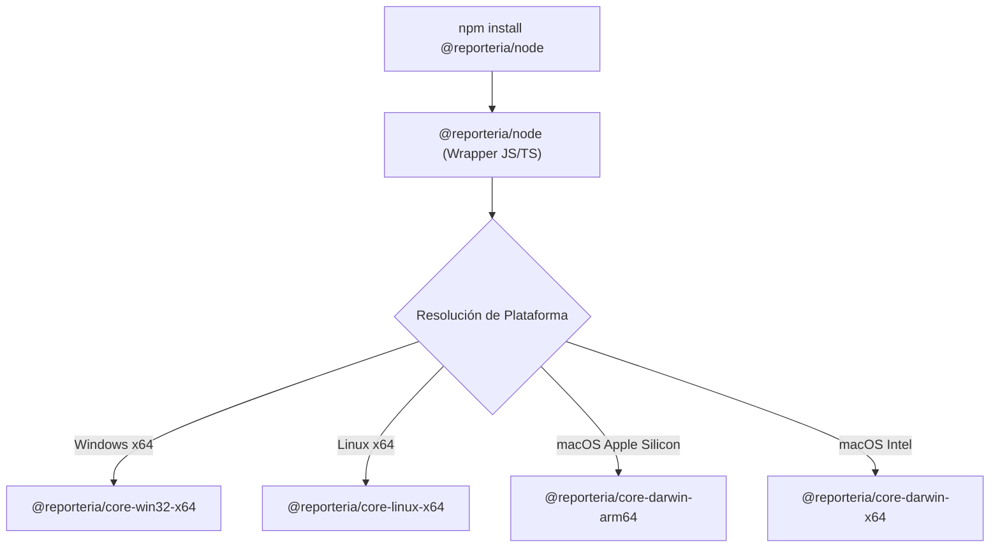

# Especificación 07: Publicación en npm y Distribución en Go

## 1. Objetivo
Diseñar y estructurar la estrategia de empaquetado, versionado y distribución para que la biblioteca pueda ser instalada y consumida fácilmente tanto por la comunidad de **Go** (`go get`) como por el ecosistema de **Node.js** (`npm install`).

---

## 2. Publicación y Uso en Go

### 2.1 Estructura del Módulo Go
- Módulo canónico: `github.com/<usuario>/reporteria-go` (o el repositorio definitivo).
- Consumo nativo por desarrolladores Go:
  ```bash
  go get github.com/<usuario>/reporteria-go
  ```
- Versionado semántico estricto con etiquetas Git (`v1.0.0`).
- Exportación limpia de paquetes:
  - `pkg/reporter`: API Fluida principal.
  - `pkg/charts`: Motor de gráficos vectoriales.
  - `pkg/exporters/...`: Exportadores individuales.

---

## 3. Estrategia de Publicación en npm (Multiplataforma)

La distribución de binarios Go dentro de paquetes npm sigue el patrón probado de herramientas como **esbuild**, **Biome** y **Turbo**:



### 3.1 Ventajas de Cross-Compilation en Go Puro
Dado que nuestro motor tiene **cero dependencias CGO**, compilar para todas las plataformas desde cualquier máquina (incluso desde Windows) es nativo e instantáneo con variables de entorno estándar de Go:
- `GOOS=windows GOARCH=amd64 go build -o bin/reporteria-windows-amd64.exe`
- `GOOS=linux GOARCH=amd64 go build -o bin/reporteria-linux-amd64`
- `GOOS=darwin GOARCH=arm64 go build -o bin/reporteria-darwin-arm64`

### 3.2 Empaquetado del Wrapper de Node.js
- **Soporte Dual ESM y CommonJS**:
  - Compilación con TypeScript (`tsc` o `tsup`) generando módulos `.mjs` y `.cjs` con definiciones de tipos completas (`.d.ts`).
- **Resolución Automática del Binario**:
  - `binary-resolver.ts` detecta `process.platform` y `process.arch` para seleccionar el ejecutable correspondiente en milisegundos.

---

## 4. Pipeline de Automatización (GitHub Actions)

1. **Test Matrix**:
   - Ejecutar `go test -v ./...` en Ubuntu, Windows y macOS.
   - Ejecutar `npm test` en el wrapper de Node.
2. **Build de Binarios Multiplataforma**:
   - Generación de binarios optimizados (con flags `-ldflags="-s -w"` para reducir el tamaño al mínimo).
3. **Publicación Automatizada**:
   - Tag de versión ➔ Creación de GitHub Release con los binarios adjuntos.
   - Publicación del paquete principal y sub-paquetes a **npm registry**.

---

## 5. Criterios de Aceptación
1. Un desarrollador de Node.js debe poder ejecutar:
   ```bash
   npm install reporteria-node
   ```
   y generar un reporte inmediatamente sin tener Go instalado en su máquina.
2. Un desarrollador de Go debe poder importar `github.com/<usuario>/reporteria-go/pkg/reporter` y compilar su aplicación sin ninguna configuración adicional.
